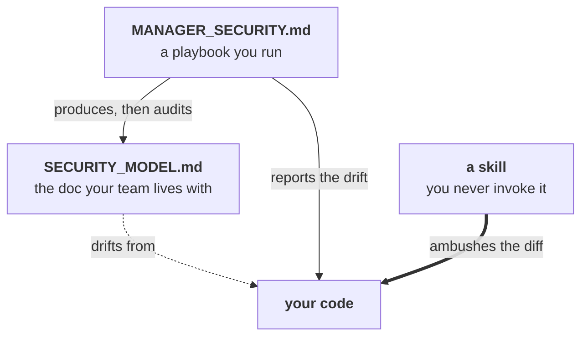

# ai-product-builder

Playbooks, templates and agent skills for solo founders shipping products with Claude Code.

You copy it into your repo and run it *against* your repo. There is no package to install and
nothing to import — the artifacts are markdown, and the runtime is your coding agent.

```bash
git clone https://github.com/interdisciplinary-xyz/ai-product-builder
cd ai-product-builder
npm run deploy -- ../my-app/docs        # 95 docs + commands, skills, agents, calculators
```

```
my-app/docs/
├── RELEASE_MANAGER.md        ← staged-branch CI policy, «placeholders» ready to fill
├── SECURITY_MODEL.md         ← auth tiers, IDOR guard, webhook signing
├── MANAGER_SECURITY.md       ← the playbook that audits the file above
├── … 92 more
├── commands/                 → .claude/commands/     (11 slash-commands)
├── skills/                   → .claude/skills/       (4 ambient rules)
└── agents/                   → .claude/agents/       (4 exec lenses + template)
```

## Why

Every repo you start re-litigates the same forty decisions: how releases are cut, what a PR
must contain, when an ADR is required, what "done" means for a payment path. You answer them
badly, under time pressure, in a Slack thread nobody can find six weeks later.

This library is those decisions, written down once, as documents an AI agent can *execute* —
not just read.



You **run** a playbook. You **fill** a runbook. A **skill** you never invoke at all — it fires on
its own, at the moment you're about to make the mistake it knows about. The
[exec board](CATALOG.md#exec-board) is a fifth thing: four read-only advisors, convened by
`/board`, which reports where they **disagree**.

**What it is not:** a Claude Code plugin, a marketplace, or a framework. It is a pile of
opinionated markdown and a build script. If you want something that installs and does things to
your codebase automatically, this is the wrong repo — see [Alternatives](#alternatives).

> [!IMPORTANT]
> **This is policy declared in prose, not enforcement deployed in CI.** The "REQUIRED" markers
> throughout the library are intentions until you wire one into a real `.github/` and watch it
> fail a PR. No repo has done that yet — see [Status](#status).

## Status

**v0.2.0.** Maintained, actively used to build the tooling in it, and **not yet proven in
production anywhere.**

Being specific, because the alternative is misleading you: `docs/ai-product-builder/` exists in
zero repos. Two repos adopted some of these documents by hand and then **disowned them** — every
playbook copy in one carries a banner reading *"NOT wired to this repo… treat as a template, not
current process."* Roughly a dozen documents here describe a process nobody has ever performed.

That's the honest state. The content is good; the adoption is unproven. Weigh accordingly.

PRs welcome — see [CONTRIBUTING.md](CONTRIBUTING.md).

## Contents

- [Why](#why) · [Status](#status) — is this for me, and is it alive
- [Adopt it](#adopt-it) — the copy, and what it overwrites
- [Use it](#use-it) — filling the `«placeholders»`, running a playbook
- [What's inside](#whats-inside) — the six layers, with counts
- [Start here](#start-here) — three doors, by what you came for
- [What this library believes](#what-this-library-believes) — the four opinions
- [Known weak points](#known-weak-points) — what you'd be signing up for
- [Alternatives](#alternatives) · [Contributing](#contributing) · [License](#license)

## Adopt it

```bash
npm run deploy -- ../my-app/docs
```

That's the whole adoption story, and it has four properties worth stating plainly:

**It is a copy, not a dependency.** The files land in your repo and belong to you.

**Updating means re-running the command.** There is no sync mechanism. **Local edits to deployed
files will be overwritten.** That's the contract — fill the `«placeholders»`, but if you fork a
document's *structure*, you own it from then on.

**Names change on the way in.** `RUNBOOK_METRICS.md` deploys as `METRICS.md` — the prefix is a
shipping-crate label, not part of the name. Playbooks keep their `MANAGER_` prefix so they stay
recognisable as library artifacts. ([Why](CONTRIBUTING.md#why-the-prefixes-behave-differently).)

**Three layers install outside `docs/`.** Commands, skills and agents belong in `.claude/`:

```bash
cd ../my-app
mkdir -p .claude/commands .claude/skills .claude/agents
cp -r docs/commands/* .claude/commands/
cp -r docs/skills/*   .claude/skills/
cp -r docs/agents/*   .claude/agents/
```

## Use it

Every document ships full of `«PLACEHOLDER»` tokens. `/ai-init` fills them by asking you, once,
and remembering the answers for every subsequent document.

```
/ai-init RELEASE_MANAGER
```

```
NODE_VERSION   found .nvmrc → 22.15.1        [Enter to accept]
PKG_MGR        found package.json → pnpm     [Enter to accept]
TRUNK          found git → main              [Enter to accept]
QUALITY_CMD    ? pnpm ci:quality
```

Answers persist to `.claude/ai-init.local.json` (committed). The next document only asks about
tokens it hasn't seen. Secrets are refused, not stored.

Then run a playbook against your repo:

```
Run MANAGER_SECURITY.md against this codebase.
```

It reads `SECURITY_MODEL.md`, walks your routes, and reports what the document claims versus
what the code does.

## What's inside

| Layer | Count | What it is |
|---|:--:|---|
| **Playbooks** (`MANAGER_*`) | 25 | Prompts you *run* against a repo. They create, verify, or audit a document. |
| **Templates** (`RUNBOOK_*`) | 64 | Documents you *fill*. This is what your team lives with. |
| **Slash-commands** | 11 | 7 workflow + 4 recurring audits that write dated reports and open an issue **only on regression**. |
| **Skills** | 4 | Ambient rules that fire **without being asked**, at the moment you're about to make the mistake. |
| **Exec board** (`AGENT_*`) | 4 | Read-only advisory lenses — CEO, CFO, CPO, CTO — convened by `/board`, which synthesizes their **disagreement**. |
| **Calculators** | 2 | Python, no dependencies. A playbook that ends in a number ships the calculator that produces it. |

**[→ Full catalog](CATALOG.md)** — every artifact, grouped, with what each one is for.

## Start here

Three doors, depending on why you're here.

**"I'm evaluating whether to adopt."** Read [`RELEASE_MANAGER`](src/runbooks/RUNBOOK_RELEASE_MANAGER.md).
It's the most opinionated document in the library and the one most likely to make you disagree.
If you can live with it, the rest will fit.

**"I want the five documents that earn their keep on day one."**

1. [`RELEASE_MANAGER`](src/runbooks/RUNBOOK_RELEASE_MANAGER.md) — staged-branch CI cost control (`scope/* → release/* → main`)
2. [`QUALITY_ASSURANCE`](src/runbooks/RUNBOOK_QUALITY_ASSURANCE.md) — the pre-merge gate
3. [`SESSION_MIGRATION`](src/runbooks/RUNBOOK_SESSION_MIGRATION.md) — so the next AI session resumes instead of re-learning
4. [`SECURITY_MODEL`](src/runbooks/RUNBOOK_SECURITY_MODEL.md) — auth tiers, IDOR guard, webhook signing
5. [`PRODUCT_CONTEXT`](src/managers/MANAGER_PRODUCT_CONTEXT.md) — what you're building and what you refuse to build

**"Just show me the single best thing in here."**
[`SKILL_TESTS_THAT_CANNOT_FAIL`](src/skills/SKILL_TESTS_THAT_CANNOT_FAIL.md) — three assertion
shapes that pass *identically* against broken and fixed code. One of them shipped a fully
deployed, e2e-tested route that zero pages referenced, for months, with CI green.

## What this library believes

Four opinions, which you're free to reject — but they're why the documents look the way they do.

**A green test suite is not evidence.** Before a regression guard is worth writing, run it
against the pre-fix code and watch it fail. If it passes, it asserts nothing.

**An audit that reports the same twelve false positives forever gets run twice and then never
again.** So every audit command carries a *known-legitimate-exceptions* list, diffs against its
last run, and opens an issue **only when a number gets worse**.

**The human merges, deploys, and touches secrets.** The agent may do everything local and
everything draft-shaped. That line is enforced by a permission deny-list, not by good intentions.

**A doc is opened by someone who already decided to act; a skill has to ambush them.** Nobody
thinks *"I should consult the never-throws document"* while writing a `try/catch`. That's the
whole reason the skill layer exists — and why a skill without a `description` is just a document
in the wrong folder. ([The rule](CONTRIBUTING.md#skill-or-doc).)

## Known weak points

We'd rather you hear these from us.

| Weak point | What it means for you |
|---|---|
| **Never deployed end to end** | Nothing here has been proven against a real repo's CI. You'd be first. |
| **41 unregistered tokens** | Four slash-commands use `«placeholders»` that `/ai-init` can't prompt for. You'd fill them by hand. |
| **No sync mechanism** | Re-running `deploy` overwrites. When the library updates, your copy drifts silently until you re-copy. |
| **A dozen unexercised documents** | Some playbooks describe a process nobody has ever run. They're theory. |
| **Context cost** | Playbooks run 200–400 lines. Running several in one session burns a lot of an agent's context. |

## Alternatives

Use something else if:

- **You want agents and skills that install themselves.** This library is markdown you copy;
  a plugin marketplace is a better fit. Start with [`anthropics/skills`](https://github.com/anthropics/skills)
  or [`wshobson/agents`](https://github.com/wshobson/agents).
- **You want breadth over opinion.** This library takes hard positions — staged-branch releases,
  domain-scoped E2E, a permission deny-list. An `awesome-*` list will give you more options and
  fewer arguments.
- **You have a team with an established process.** These documents are written for a solo founder
  or a small team deciding things for the first time. If you already have a release policy, you
  don't need ours — take the [skills](CATALOG.md#skills) and leave the rest.

What you get here that those don't: the playbooks and the documents are **paired**, so a document
has something that audits it, and the whole thing is meant to be *run*, not read.

## Contributing

See [CONTRIBUTING.md](CONTRIBUTING.md) — repo layout, the skill-or-doc rule, token conventions,
and the release process. Run `npm run check` before opening a PR.

## License

**Not licensed.** No `LICENSE` file has been chosen, so by default all rights are reserved by the
copyright holder (Michał Dopieralski / interdisciplinary-xyz). The repository is private; if you
want to use this outside the org, ask first.
