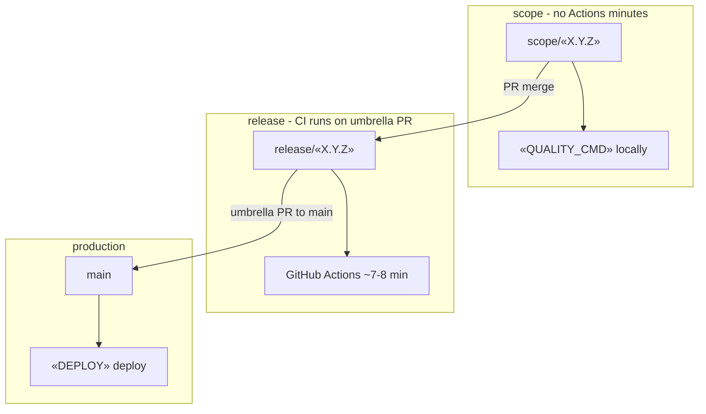

# GitHub Actions — minutes-saving branch workflow

How we use branches and CI to keep GitHub Actions spend low while still gating production.

> **🔧 Reuse & local setup**
>
> **🚀 First time?** Run `/ai-init RUNBOOK_GITHUB_ACTIONS` to fill the local definitions below interactively (or invoke `MANAGER_INIT.md`).
>
> Canonical copy — vendored at `docs/ai-product-builder/RUNBOOK_GITHUB_ACTIONS.md` in every deployed repo (source of truth). Fill the `«placeholders»` below in place via `/ai-init`.
>
> **Reusability:** template-ready — the branch/CI cost model is generic; product specifics (package manager, deploy platform, job names, secrets) are isolated to the tokens below.
>
> **Local definitions to provide per repo** (fill the placeholders in this doc, or define once in the repo's `.claude/CLAUDE.md`):
> - `«PKG_MGR»` — package manager (e.g. pnpm); used in `«QUALITY_CMD»`, `«BUILD_CMD»`, `«E2E_CMD»`.
> - `«QUALITY_CMD»` — the local pre-merge gate mirroring the CI `quality` job (e.g. `pnpm ci:quality`: format + lint + types + unit).
> - `«BUILD_CMD»` / `«E2E_CMD»` — build and e2e commands (e.g. `pnpm build`, `pnpm test:e2e --project=chromium`).
> - `«BRANCH_NAMING»` — release/scope/fix/feat conventions (`release/«X.Y.Z»`, `scope/«X.Y.Z»`, `fix/<issue>-*`, `feat/<issue>-*`) and which heads skip CI. See [`RELEASE_MANAGER.md`](./RELEASE_MANAGER.md) for the canonical naming policy.
> - `«CI_JOB_NAMES»` — required status-check names (`commit naming`, `lint + format + types + unit`, `e2e (build + playwright)`) for branch protection.
> - `«DEPLOY»` — production deploy target on «TRUNK» (e.g. Vercel) and whether previews build on every PR.
> - `«E2E_STACK»` — test runner + DB harness (e.g. Playwright + (in-memory «DB_CMS» for tests) via «E2E_BOOTSTRAP»).
> - `«DOMAIN_PATHS»` — where domains live, for change detection (e.g. `src/domains/[^/]+`) — see Domain-scoped E2E.
> - `«SHARED_PATHS»` — cross-cutting paths that force the FULL suite; a **single committed list** (e.g. `.github/shared-paths.txt`) read by `detect` and the docs (no restating).
> - `«API_ROUTES»` — API route glob for the OpenAPI/route-security parity gate (e.g. `app/api/**/route.ts`).
> - E2E↔domain mapping — how specs map to domains: path (`e2e/<domain>/**`) or tag (`@<domain>`).
> - `«WORKFLOW_FILES»` — paths under `.github/workflows/` (`ci.yml`, `release.yml`, `page-speed-insights.yml`) and the CI secrets they need (e.g. database-cluster credentials, tunnel/ingress secrets).
> - `«CURRENT_RELEASE_DOC»` — link to the active release/progress doc (e.g. `docs/v«X.Y.Z»-progress.md`).

## Branch model

```text
main                    Production («DEPLOY» deploy on merge)
  ↑
  PR  release/«X.Y.Z» → main     ← full CI runs here (~7–8 min per push)
  │
release/«X.Y.Z»         Release umbrella (milestone integration)
  ↑
  PR  scope/«X.Y.Z» → release/«X.Y.Z»   ← CI skipped (0 runner minutes)
  │
scope/«X.Y.Z»           WIP aggregate (feature work lands here first)
```

The branch-naming convention itself is **policy** — see [`RELEASE_MANAGER.md`](./RELEASE_MANAGER.md) §1. This doc covers the CI implementation that enacts it. In short: `fix/<issue>-short-name` or `feat/<issue>-short-name` cut from `release/«X.Y.Z»` are for isolated reviews; those heads are **not** `scope/**`, so **CI will run** on PRs into `release/**` unless you rename them or extend the skip rule.

## Design goals

| Layer                 | GitHub Actions         | Quality gate                                          |
| --------------------- | ---------------------- | ----------------------------------------------------- |
| `scope/**`            | **Off** (skipped jobs) | Local: `«QUALITY_CMD»` (+ e2e when touching flows)    |
| `release/**` → `main` | **On** (full pipeline) | CI must be green before merge to `main`               |
| Random topic branches | **Off** (no PR target) | (git hooks) pre-commit / pre-push hooks locally       |
| `main` push           | **On**                 | Same pipeline as PR (safety net after merge)          |

Production deploy is **«DEPLOY» on `main`**, not a GitHub deploy job. Actions **verify**; «DEPLOY» **ships**.

## When workflows run

Configured in [`.github/workflows/ci.yml`](../.github/workflows/ci.yml).

### Pull requests

| Base branch  | Head branch                    | CI (`commitlint` / `quality` / `e2e`)        |
| ------------ | ------------------------------ | -------------------------------------------- |
| `main`       | `release/**`                   | **Runs**                                     |
| `main`       | anything else (not `scope/**`) | **Runs**                                     |
| `release/**` | `scope/**`                     | **Skipped** (all three jobs)                 |
| `release/**` | `fix/**`, `feat/**`, etc.      | **Runs**                                     |
| Other        | any                            | **Does not trigger** (base not in allowlist) |

PRs that **only** change markdown under `docs/**`, `**/*.md`, or `LICENSE` do not trigger CI at all (`paths-ignore`). Use that for roadmap-only edits; do not rely on it for code.

### Push events

| Branch       | CI                                           |
| ------------ | -------------------------------------------- |
| `main`       | **Runs** (same pipeline, docs paths ignored) |
| `release/**` | **Does not run** on push alone               |
| `scope/**`   | **Does not run**                             |

After you merge `scope/«X.Y.Z»` → `release/«X.Y.Z»`, CI runs on the **open umbrella PR** `release/«X.Y.Z»` → `main` when GitHub updates that PR’s head — not from a separate push hook on `release/**`.

### Other workflows

| Workflow                                                                  | PR trigger                     | Notes                                                   |
| ------------------------------------------------------------------------- | ------------------------------ | ------------------------------------------------------- |
| [`page-speed-insights.yml`](../.github/workflows/page-speed-insights.yml) | No                             | `workflow_dispatch` only (uses dedicated CI secrets — e.g. database-cluster creds + tunnel/ingress) |
| [`release.yml`](../.github/workflows/release.yml)                         | No                             | `push` to `main` — version bump only                    |
| «DEPLOY»                                                                  | All PRs (including `scope/**`) | Separate from Actions minutes; previews may still build |

### Manual runs

`workflow_dispatch` on CI runs the full pipeline on demand (use sparingly — full minute cost).

## What each CI job costs (approx.)

Single workflow run on a non-scope PR:

| Job                            | Tier | ~Duration | Purpose                                                           |
| ------------------------------ | ---- | --------- | ----------------------------------------------------------------- |
| `commit naming`                | 0    | ~20 s     | Conventional Commits on latest commit                                          |
| `lint + format + types + unit` | 1    | ~1–2 min  | Fast gate; blocks e2e if red                                                   |
| `e2e (build + playwright)`     | 2    | ~5–7 min  | `«BUILD_CMD»`, Playwright + (in-memory «DB_CMS» for tests) (`«E2E_BOOTSTRAP»`) |

**Total per full run: ~7–8 minutes** of `ubuntu-latest` runner time.

Cost controls baked into the workflow:

- **Scope skip** — `scope/**` PRs skip all jobs (`if: !startsWith(github.head_ref, 'scope/')`).
- **e2e gated on quality** — failed lint/types never start Playwright.
- **Build once** — production build in the e2e job only (not duplicated in quality).
- **Concurrency** — new push cancels in-progress run on the same ref (`ci-${{ github.ref }}`).
- **Caching** — «PKG_MGR» store, framework build cache, Playwright, and the in-memory «DB_CMS» binary via composite setup action.
- **Domain-scoped E2E (required)** — the `e2e` job runs only the changed domains' specs; the full suite runs only on shared-code changes (see [Domain-scoped E2E](#domain-scoped-e2e-required)).

## Domain-scoped E2E (required)

**Required for domain-driven repos** — see [`RELEASE_MANAGER.md`](./RELEASE_MANAGER.md) §4.2 for the
policy. The `e2e` job MUST run **only the E2E of the domains whose files changed** (union when
several), and fall back to the **full** suite when shared code changes. Implement it as a
**dynamic matrix**:

```yaml
jobs:
  detect:                                           # cheap: compute changed domains
    if: ${{ !startsWith(github.head_ref, 'scope/') }}
    runs-on: ubuntu-latest
    outputs:
      domains: ${{ steps.scan.outputs.domains }}    # e.g. ["auth","headless"]
      full:    ${{ steps.scan.outputs.full }}        # "true" → run whole suite
    steps:
      - uses: actions/checkout@v4
        with: { fetch-depth: 0 }                     # history needed for the diff base
      - id: scan
        run: |
          BASE="${{ github.event.pull_request.base.sha || github.event.before }}"
          FILES=$(git diff --name-only "$BASE"...HEAD)
          if echo "$FILES" | grep -qE -f .github/shared-paths.txt; then   # «SHARED_PATHS» single source of truth
            echo 'full=true'  >> "$GITHUB_OUTPUT"; echo 'domains=[]' >> "$GITHUB_OUTPUT"
          else
            DOMAINS=$(echo "$FILES" | grep -oE '«DOMAIN_PATHS»' \
              | sed -E 's#.*/([^/]+)/.*#\1#' | sort -u | jq -R . | jq -cs .)
            echo "domains=$DOMAINS" >> "$GITHUB_OUTPUT"; echo 'full=false' >> "$GITHUB_OUTPUT"
          fi

  e2e:                                               # one parallel job per changed domain
    needs: [quality, detect]
    if: ${{ needs.detect.outputs.full == 'false' && needs.detect.outputs.domains != '[]' }}
    strategy: { matrix: { domain: ${{ fromJSON(needs.detect.outputs.domains) }} } }
    runs-on: ubuntu-latest
    steps:
      - run: «E2E_CMD» e2e/${{ matrix.domain }}      # or: --grep "@${{ matrix.domain }}"

  e2e-full:                                          # shared change → whole suite
    needs: [quality, detect]
    if: ${{ needs.detect.outputs.full == 'true' }}
    runs-on: ubuntu-latest
    steps:
      - run: «E2E_CMD»

  e2e-gate:                                          # ONE stable required status check
    needs: [e2e, e2e-full]
    if: ${{ always() }}
    runs-on: ubuntu-latest
    steps:
      - run: |
          R='${{ needs.e2e.result }}'; F='${{ needs.e2e-full.result }}'
          if [ "$R" = failure ] || [ "$F" = failure ]; then exit 1; else exit 0; fi
```

**Required guardrails:**
- Keep `«SHARED_PATHS»` accurate (shared libs, design system, config, lockfile, CI, cross-domain contracts/fixtures) — these force the full suite.
- `quality` (lint/format/types/unit) and `build` still run **full** — only E2E is scoped.
- Make **`e2e-gate`** the single required E2E status check in branch protection. The per-domain `e2e` matrix is dynamic (and may be empty when no domain changed), so gating on it directly would block legitimate PRs; `e2e-gate` always runs and reports one stable result.
- Needs `fetch-depth: 0` for the diff base; the same detection mirrors `RUNBOOK_RELEASE_MANAGER.md` §4.2 so local and CI agree.

## Required CI gates

Beyond the domain-scoped E2E above, these run as **required** status checks. Reuse the same
`detect` job (changed domains + `full`) to scope the expensive, partitionable ones; the cheap
whole-repo gates run on every PR.

**Scoped to changed domains** (reuse `detect`; a `*-gate` aggregator is the required check):
- **`unit`** — domain-scoped unit/integration on `feat/*`/`fix/*` PRs (affected runner: `«TEST_CMD»` changed-mode; full on `«SHARED_PATHS»` change). Required check: **`unit-gate`**. Types/lint stay full in `quality`. See [`RELEASE_MANAGER.md`](./RELEASE_MANAGER.md) §4.1.
- **`visual`** + **`axe`** — domain-scoped visual-regression and a11y at the release merge; the a11y `KNOWN_VIOLATIONS` allowlist must **shrink, not grow**. See [`QUALITY_ASSURANCE.md`](./QUALITY_ASSURANCE.md).

**Whole-repo gates** (cheap, every PR):
- **`boundaries`** — domain-boundary lint: no cross-domain deep imports (only via a domain's public barrel), dependency direction `domain → shared` only, no cycles. **This is what makes the domain scoping above sound.** See [`MANAGER_ARCHITECTURE.md`](./MANAGER_ARCHITECTURE.md).
- **`secrets`** — secret scan (e.g. `gitleaks`).
- **`deps`** — dependency audit (e.g. `osv-scanner` / `«PKG_MGR» audit --audit-level=high`).
- **`api-parity`** — fail if the diff touches `«API_ROUTES»` but not the OpenAPI spec / route-security registry (mechanizes the "same commit" rule). See [`QUALITY_ASSURANCE.md`](./QUALITY_ASSURANCE.md).
- **`adr`** — fail if the PR adds a dependency / new domain / changes a domain's public barrel without a `DECISION_LOG.md` entry. See [`DECISION_LOG.md`](./DECISION_LOG.md).
- **`forbidden-tokens`** *(payments repos)* — the custody-field static check runs unconditionally (not a manual checkbox). See [`SECURITY_MODEL.md`](./SECURITY_MODEL.md).

`«SHARED_PATHS»` is a **single committed list** (`.github/shared-paths.txt`); `detect` and the
local snippets read it via `grep -E -f` — no doc or job restates the list.

> **Branch protection — required checks:** the **aggregator/whole-repo** jobs only —
> `commit naming`, `quality`, `e2e-gate`, `unit-gate`, `boundaries`, `secrets`, `deps`,
> `api-parity`, `adr` (+ `forbidden-tokens` for payments). The **dynamic matrices**
> (`e2e`, `unit`, `visual`, `axe`) must **not** be required directly — they vary per PR and
> may be empty.

## Day-to-day workflow

### 1. Open a release line

```bash
git checkout main && git pull
git checkout -b release/«X.Y.Z»
# roadmap doc, etc.
git push -u origin release/«X.Y.Z»
```

Open umbrella PR: **`release/«X.Y.Z»` → `main`** (draft until milestone done). This PR is where **paid CI** runs for the release.

### 2. Work on scope (no Actions minutes)

```bash
git checkout release/«X.Y.Z» && git pull
git checkout -b scope/«X.Y.Z»   # or stay on existing scope branch
# … commits …
git push origin scope/«X.Y.Z»
```

Open PR: **`scope/«X.Y.Z»` → `release/«X.Y.Z»`**. GitHub shows CI jobs as **Skipped** — expected.

**Before merging scope → release**, run locally:

```bash
«QUALITY_CMD»
# when touching auth, CMS pages, locale routing, header/footer:
«E2E_CMD»
```

`«QUALITY_CMD»` mirrors the CI `quality` job: format, lint, types, unit tests.

### 3. Integrate scope into release

Merge PR `scope/«X.Y.Z»` → `release/«X.Y.Z»`. That updates the head of umbrella PR `release→main`; GitHub re-runs **full CI** there.

Fix failures on `release/«X.Y.Z»` (or merge another scope batch) until umbrella PR is green.

### 4. Ship to production

Merge **`release/«X.Y.Z»` → `main`** when milestone acceptance is met. «DEPLOY» deploys production from `main`.

## Flow diagram



## Branch protection (recommended)

| Branch       | Suggested rules                                                                                                 |
| ------------ | --------------------------------------------------------------------------------------------------------------- |
| `main`       | Require CI checks (`commit naming`, `lint + format + types + unit`, `e2e (build + playwright)`); no direct push |
| `release/**` | Optional: allow merge from `scope/**` without required checks (checks are skipped anyway)                       |
| `scope/**`   | No required Actions checks                                                                                      |

If `main` requires status checks, a `scope/**` PR must **not** target `main` directly — always go through `release/**`.

> **With domain-scoped E2E enabled, make `e2e-gate` the required E2E check** — not the per-domain `e2e` matrix jobs, which vary per PR and may be empty. See [Domain-scoped E2E](#domain-scoped-e2e-required).

After migrating from the old split workflows (`[CI] Quality + Vitest Unit`, `[CI] Playwright e2e`), update required status check names in GitHub branch protection to match the job names above.

## What this does not save

- **«DEPLOY»** preview builds on every PR (including `scope/**`) — configure ignore rules in «DEPLOY» if previews are not needed on scope.
- **Rework cost** — skipping CI on scope shifts responsibility to local runs before merge to `release/**`.
- **`fix/*` into `release/**`** — still runs full CI unless you adopt scope naming or extend skip rules.

## Transient-failure tolerance (network flakes, floating versions, prettier drift)

Three failure modes look identical on the PR check card and are not the same failure:
a real regression, a transient network flake, and a version drift. Left as-is they train
the team to "just re-run" every red check — after which a real bug wearing the same colour
ships. See [`SKILL_CI_TRANSIENT_FAILURE_TOLERANCE.md`](./SKILL_CI_TRANSIENT_FAILURE_TOLERANCE.md)
for the full doctrine; this section is the CI implementation.

### npm-audit retry loop

`«PKG_MGR» audit` hits the npm registry endpoint (`registry.npmjs.org/-/npm/v1/security/audits`),
which is not a nine-nines service. A single `ECONNRESET` fails the step, fails the check, and
re-running is the only path to green.

Wrap every audit step in a bounded (≤5) retry loop with 30-second backoff:

```yaml
- name: Audit dependencies (retry on transient network failure)
  run: |
    for attempt in 1 2 3 4 5; do
      echo "audit attempt $attempt"
      if «PKG_MGR» audit --prod --audit-level=high; then
        exit 0
      fi
      echo "attempt $attempt failed; sleeping 30s"
      sleep 30
    done
    echo "audit failed 5 times; treating as real"
    exit 1
```

**A real vuln still fails deterministically on every attempt** — the loop still exits 1 and
the check still goes red. What the loop absorbs is the socket-timeout class, which succeeds
on attempt 2 or 3.

If you want the retry to be *provably* targeted at network errors, grep the output for the
transient-error signature before sleeping:

```bash
if ! echo "$out" | grep -qE 'ECONNRESET|ETIMEDOUT|socket hang up|EAI_AGAIN|network timeout|Failed to fetch'; then
  echo "non-network failure — real"
  exit 1
fi
```

Apply the same shape to any registry-touching step: `«PKG_MGR» install --frozen-lockfile`,
`npm publish`, `npm view`.

### `@lhci/cli` pinning

**Never invoke `@lhci/cli` at `@X.Y.x` or naked `npx @lhci/cli`.** `0.13.x` (and similarly
floating patches) resolved to a version that wedges on dev-server startup — the failure
was a hang, not a message, which consumed the entire runner timeout before failing.

Pin to a specific `x.y.z`:

```yaml
- name: Lighthouse
  run: npx @lhci/cli@«LHCI_VERSION» autorun     # e.g. @lhci/cli@0.13.0
```

Or install into devDeps: `"@lhci/cli": "«LHCI_VERSION»"` — same effect, one file to bump.

If the underlying wedge is architectural (dev-server startup, Chrome launch), mark the whole
Lighthouse job **advisory** so it never blocks a merge — but only if the job is advisory by
design (perf gates ratchet in a separate workflow — see [`MANAGER_PERFORMANCE.md`](./MANAGER_PERFORMANCE.md)):

```yaml
- name: Lighthouse (advisory — never blocks merge)
  timeout-minutes: 10
  continue-on-error: true
  run: |
    timeout 600 npx @lhci/cli@«LHCI_VERSION» autorun || {
      echo "::warning::Lighthouse advisory job did not finish — see run logs"
      exit 0
    }
```

Name the job `Lighthouse (advisory)` so the check-runs UI is honest about what green means.
Pair `continue-on-error: true` only with names that carry `(advisory)`; a blocking gate with
`continue-on-error: true` is a lie.

Schedule a monthly renovate/dependabot bump PR for the pinned tool, gated on the same
Lighthouse run — that is the cheap check that keeps the pin honest.

### Prettier version alignment

Pre-commit's `prettier --write` and CI's `prettier --check` produce **different output** if
their versions differ. Markdown tables are the classic case: column-alignment rules changed
between minor versions, and the diff on the failed CI run is columns of spaces nobody typed.
Every PR carrying a table needs a "fix formatting" commit before green.

Pin `prettier` in `devDependencies` to an exact version:

```json
{
  "devDependencies": {
    "prettier": "«PRETTIER_VERSION»"
  }
}
```

Invoke it via `«PKG_MGR» exec prettier` in both pre-commit AND CI — **never bare `prettier`**,
which resolves to whatever is on the PATH first (corepack cache, `npm-global`, Homebrew):

```yaml
# .github/workflows/ci.yml
- run: «PKG_MGR» install --frozen-lockfile
- run: «PKG_MGR» exec prettier --check "**/*.md" "**/*.{ts,tsx,json,yml,yaml}"
```

```bash
# .husky/pre-commit (or lint-staged config)
«PKG_MGR» exec prettier --write --list-different "**/*.md"
```

Verify alignment by running the CI's exact command locally on a fresh install:

```bash
«PKG_MGR» install --frozen-lockfile
«PKG_MGR» exec prettier --check "**/*.md"    # zero diffs = versions aligned
```

### The proof obligation

The full skill (`SKILL_CI_TRANSIENT_FAILURE_TOLERANCE.md`) names three proof obligations:

1. **The retry loop still fails** when the underlying failure is real (add a package with a
   known high-severity advisory, watch the workflow fail on every attempt and exit 1).
2. **`@lhci/cli` versions are pinned** — `grep -rE '@lhci/cli@\d+\.\d+\.(x|\d+)' .github/workflows/ package.json`
   should return zero matches ending in `.x`.
3. **Prettier is aligned** — `«PKG_MGR» exec prettier --check "**/*.md"` produces zero diffs
   on a fresh CI-equivalent install.

## Related docs

- Release policy (POLICY doc this implementation enacts): [`RELEASE_MANAGER.md`](./RELEASE_MANAGER.md)
- Retry / pin / advisory doctrine: [`SKILL_CI_TRANSIENT_FAILURE_TOLERANCE.md`](./SKILL_CI_TRANSIENT_FAILURE_TOLERANCE.md)
- Current release: «CURRENT_RELEASE_DOC»
- CI env placeholders: [`.github/ci.env`](../.github/ci.env)
- Local dev / Portless: [`DEV_PORTLESS.md`](./DEV_PORTLESS.md)
